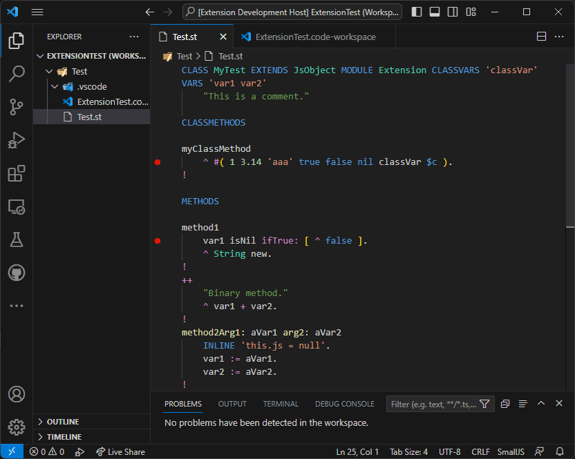

# SmallJS VSCode extension

The SmallJS VSCode extension provides syntax coloring
and debugging (breakpoint) support when developing in SmallJS.

## Features

This is how it looks in action:

## Requirements

To enable the extension globally run the script: `install.sh`

## Extension Settings

None.

## Known Issues

Unary method names have the same color as variables.

## Release Notes

### 1.3.0

- Marketplace page now shows this description.
- Quotes are no longer auto-closed inside strings and comments.
- Assignments without a space, like `x:= 1`, are no longer colored as method names.
- Improved coloring of numbers.

### 1.0.0

Initial release.
