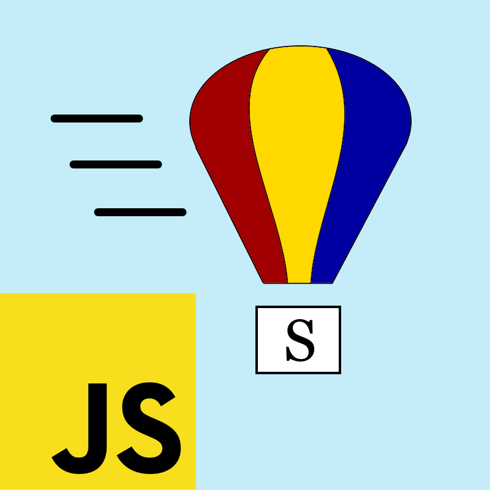
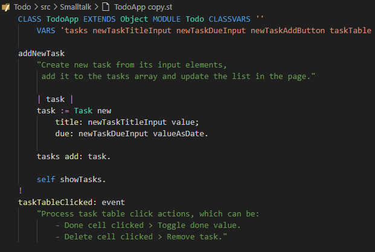

# SmallJS README

	
	 
	<label>Official website: </label>
	<a href="https://small-js.org" style="font-weight: bold;">small-js.org</a>

## News - SmallJS 2.3 released - 18-OCT-2026

New features are:

### Compiler

- Debugging: Enhanced debugging in SmallJS by allowing breakpoints in more places:\
  In assignments, constant statements and especially with blocks!\
  Step-into debugging is now disabled for common classes like Integer and String,\
  giving a nice, streamlined debugging experience.

### Smalltalk library

- Electron: Added full support for core Electron JS base classes.\
  Updated the Electron example app to show it off.\
  The example app NodeGui has been moved to contributions,\
  leaving NW.js and Electron as fully supported desktop options.

- Browser: Added functionality and tests to classes:\
  Animation, FromData, History, Iframe, Permissions, Storage, WebWorker,\
  Canvas, DomMatrix, Geolocation, Clipboard, MediaQuery.

- Node: Added functionality and tests to classes:\
  Fs, Fsp, NodeWorker, Buffer, NodeMessagePort.

- Core: Added functionality and tests to classes:\
  Event types, File, streams.

- AI: Expanded option support for Anthropic.

### Tutorial

- AI: Tutorial video to create a Tic-tac-toe game in SmallJS using Claude AI!\
  See the Tutorial home page for the link.\
  Claude writes the SmallJS code, which is well structured and maintainable.

### Disclaimer

The code in this release was partially built with AI (Claude).\
Great care was taken ensure that every generated line of code\
conforms to the code quality standards of the existing project.

## Introducing SmallJS

SmallJS is a free and open source implementation of the elegant and powerful Smalltalk-80 (ST) language.\
It compiles to JavaScript (JS) that runs in modern browsers or in recent Node.js.\

SmallJS is file based, not image based, so you can develop in your favorite IDE.\
The default setup is for Visual Studio Code, with ST syntax coloring and step-debugging!\
You code separately from the SmallJS base libraries (image).\
Only the parts you use are imported automatically when running your app.

SmallJS is _fully_ object oriented, so customizable on every level.\
For usability, ST class and method names are kept mostly equal to their familiar JS counterparts.

JS libraries already encapsulated in ST are:

- Browsers: Document, Window, HTML elements, events, CSS, streams.
- Node.js: HTTP server, Express, file mgmt, 5 databases, 5 AI providers.
- Desktop apps: NWjs, Electron, NodeGui.

To get you started quickly, there are several example projects using the above.

## Code example

## Installing

To install SmallJS check out:
[Installing.md](Documentation/Installing/Installing.md)

## Examples

For a first impression of running SmallJS code, see the example projects:
[Examples.md](Examples/Examples.md)

## Playground

To get a feel for Smalltalk and to quickly test out ST expressions,
a playground is accessible though the offical website:
[small-js.org/Playground](https://small-js.org/Playground)

## Documentation

The complete SmallJS documentation, including a tutorial, is located here:
[Documentation.md](Documentation/Documentation.md)

## Contributions

Contributions to SmallJS that are not part of the main system,
but show interesting applications:
[Contributions.md](Contributions/Contributions.md)

